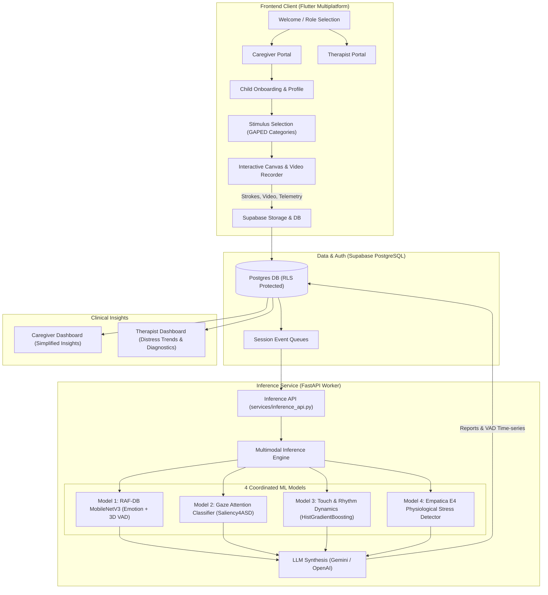

<div align="center">

# 🎨 ArtSpeak

### AI-Powered Multimodal Art Therapy & Objective Affective Assessment System for Autism Spectrum Disorder (ASD)

[](https://flutter.dev)
[](https://fastapi.tiangolo.com)
[](https://pytorch.org)
[](https://scikit-learn.org)
[](https://supabase.com)
[](https://www.python.org)
[](https://opensource.org/licenses/MIT)

*A compassionate, non-verbal assessment ecosystem bridging the gap between artistic expression, multi-sensor behavioral telemetry, and clinical therapeutic insights.*

</div>

---

## 📖 Table of Contents

- [Overview & Mission](#-overview--mission)
- [System Architecture](#-system-architecture)
- [Multimodal AI & Machine Learning Suite](#-multimodal-ai--machine-learning-suite)
  - [Model 1: Facial Emotion & 3D VAD (RAF-DB)](#1-facial-emotion--3d-vad-model)
  - [Model 2: Gaze & Visual Attention (Saliency4ASD)](#2-visual-gaze--attention-model)
  - [Model 3: Touch & Drawing Kinematics](#3-touch--drawing-rhythm-model)
  - [Model 4: Autonomic Stress & Physiology (Empatica E4)](#4-physiological-stress-detector)
  - [LLM Multi-Model Clinical Synthesis](#5-llm-clinical--caregiver-synthesis)
- [Key Features & User Portals](#-key-features--user-portals)
  - [Caregiver Portal](#caregiver-portal)
  - [Therapist Clinical Portal](#therapist-clinical-portal)
  - [Sensory-Calibrated Drawing Canvas](#sensory-calibrated-drawing-canvas)
- [Sensory-Friendly Design Principles](#-sensory-friendly-design-principles)
- [Repository Structure](#-repository-structure)
- [Getting Started & Installation](#-getting-started--installation)
  - [1. Prerequisites](#1-prerequisites)
  - [2. Database Setup (Supabase)](#2-database-setup-supabase)
  - [3. Environment Configuration](#3-environment-configuration)
  - [4. Backend Inference Worker Setup](#4-backend-inference-worker-setup)
  - [5. Frontend Application Setup](#5-frontend-application-setup)
  - [6. Running Everything Simultaneously](#6-running-everything-simultaneously)
- [Database Schema & Security (RLS)](#-database-schema--security-rls)
- [Datasets & Research Foundations](#-datasets--research-foundations)
- [License](#-license)

---

## 🌟 Overview & Mission

Many autistic individuals experience **alexithymia** and challenges with verbal emotion articulation, making traditional talk-based therapies inaccessible or overwhelming. However, non-verbal expressive modalities—specifically **drawing and visual art**—frequently offer a natural conduit for self-expression.

**ArtSpeak** transforms digital art sessions into an objective, multi-layered clinical assessment channel. While the child interacts with a soothing, stimulus-guided digital drawing canvas, ArtSpeak unobtrusively captures and synchronizes:
1. **Facial Affect & Micro-Expressions** (via front camera during stimulus and art tasks)
2. **Visual Gaze & Fixation Trajectories** (evaluating attention span and stimulus aversion)
3. **Motor & Touch Kinematics** (stroke speed, jitter, pressure variance, and rhythmicity)
4. **Autonomic Nervous System Biometrics** (electrodermal activity, blood volume pulse, heart rate, and skin temperature)

These asynchronous telemetry streams are fused by four machine learning models and synthesized by an LLM into:
- **Compassionate Caregiver Summaries**: Clear, non-stigmatizing updates on emotional regulation, interests, and creative flow.
- **Quantitative Clinical Telemetry**: Longitudinal Valence-Arousal-Dominance (VAD) trajectories, distress alerts, and regulation metrics for licensed therapists.

---

## 🏗 System Architecture



---

## 🧠 Multimodal AI & Machine Learning Suite

ArtSpeak coordinates 4 specialized models alongside an LLM synthesizer:

| Model | Modality / Data Source | Architecture / Algorithm | Primary Objective & Metrics |
| :--- | :--- | :--- | :--- |
| **Model 1: RAF-DB Emotion & VAD** | Facial Video / RAF-DB | Dual-Head MobileNetV3-Large (PyTorch) | Predicts 7 discrete emotions + continuous 3D VAD (Valence, Arousal, Dominance). **MAE: 0.25** |
| **Model 2: Visual Gaze & Attention** | Eye Tracking / Saliency4ASD | Feature Aggregator + Scikit-Learn | Quantifies visual fixation, stimulus engagement, and avoidance tendencies. |
| **Model 3: Touch & Rhythm Dynamics** | Stroke Kinematics & Drawing Events | HistGradientBoosting (Scikit-Learn) | 6 ASD affective states (*Anxious, Calm, Distressed, Engaged, Stimming, Withdrawn*). **96.8% Accuracy, 0.968 Macro F1** |
| **Model 4: Physiological Stress** | Empatica E4 Biometrics (EDA, BVP, HR, Temp) | HistGradientBoosting (116 extracted features) | Detects sympathetic autonomic stress vs. baseline state. **99.8% OOF Accuracy, 0.999 ROC-AUC** |
| **Synthesis: Clinical Report Builder** | Multimodal Model Predictions | Gemini / OpenAI Chat Completions API | Translates raw biometrics into dual caregiver-friendly and therapist diagnostic reports. |

### 1. Facial Emotion & 3D VAD Model
- **Source**: `ml-models/rafdb_emotion/`
- **Backbone**: MobileNetV3-Large feature extractor with a dual-head architecture:
  - Classification Head: 7 discrete emotional classes (Surprise, Fear, Disgust, Happiness, Sadness, Anger, Neutral).
  - Regression Head: Continuous 3D coordinates in the Valence-Arousal-Dominance space (tanh activation, range $[-1, 1]$).
- **Training Artifacts**: `confusion_matrix.png`, `learning_curves.png`, `metrics.json`.

### 2. Visual Gaze & Attention Model
- **Source**: `ml-models/gaze/`
- **Data Foundation**: Trained on Saliency4ASD (Autism Spectrum Eye-tracking dataset).
- Evaluates gaze stability, fixations on stimulus regions of interest (ROI), and pupil/gaze dispersion to measure overstimulation and visual avoidance.

### 3. Touch & Drawing Rhythm Model
- **Source**: `ml-models/touch_rhythm/`
- **Features Extracted**: Stroke velocity, acceleration, jerkiness, pressure variance, inter-stroke pause duration, curvature index, and canvas spatial entropy.
- **Classification Performance**:
  - `Anxious_Overstimulated`: F1 **0.950**
  - `Calm_Regulated`: F1 **0.966**
  - `Distressed_PreMeltdown`: F1 **0.962**
  - `Engaged_Focused`: F1 **0.968**
  - `Excited_Stimming`: F1 **0.976**
  - `Withdrawn_FlatAffect`: F1 **0.986**
- Continuous VAD Regression: $R^2 = 0.922$ (Valence), $R^2 = 0.869$ (Arousal).

### 4. Physiological Stress Detector
- **Source**: `ml-models/e4_stress/`
- **Telemetry**: Empatica E4 Wristband capturing Electrodermal Activity (EDA), Photoplethysmography / Blood Volume Pulse (BVP), Heart Rate (HR), and Skin Temperature (TEMP).
- **Validation**: 5-Fold Subject-Stratified GroupKFold across 29 subjects to prevent data leakage between individuals.
- **Result**: $0.999$ ROC-AUC with zero cross-validation overfitting (train/val gap $< 0.0001$).

### 5. LLM Clinical & Caregiver Synthesis
- **Source**: `services/inference_engine/caregiver_report_builder.py`
- Feeds synchronized outputs from all four models into an LLM with clinically grounded prompt templates.
- Produces:
  1. **Parent-Friendly Narrative**: Non-pathologizing description of session focus, positive regulation moments, and recommended home environmental adjustments.
  2. **Therapist Diagnostic Summary**: Statistical breakdown of sympathetic spikes, touch dysregulation indices, and VAD trajectory shifts.

---

## 📱 Key Features & User Portals

### Caregiver Portal
- **Child Profile Management**: Register children with age, developmental notes, and sensory preferences. No intrusive photographic PII is collected.
- **Interest Stimulus Setup**: Select interest-driven prompt themes from vetted categories (Animals, Nature, Everyday Objects, People) based on the GAPED database.
- **Session History & Progress**: Review historic session reports, mood balance, and growth milestones.

### Therapist Clinical Portal
- **Patient Roster & Triage**: High-level patient overview with active distress badges, alerting clinicians to pre-meltdown or withdrawn states.
- **Interactive VAD Trajectories**: Rich visual graphs powered by `fl_chart` tracking emotional Valence, Arousal, and Dominance over time.
- **Therapist-Child Assignment**: Secure multi-tenancy model enabling therapists to manage their clinical caseload with granular access controls.

### Sensory-Calibrated Drawing Canvas
- Multi-touch digital artboard with adjustable brush sizes, color palette, and undo/clear controls.
- Automatic recording of drawing timestamp coordinates for kinematic analysis.
- Live camera integration with countdown timer for synchronous expression tracking.

---

## 🎨 Sensory-Friendly Design Principles

Individuals with autism frequently experience sensory sensitivities. ArtSpeak’s frontend has been built strictly adhering to sensory-calibrated UI guidelines:
- **Muted, Grounded Color Palette**: Eliminates high-saturation harsh primaries and flashing elements; uses calming teals, muted indigos, and soft slate tones.
- **Zero Distracting Animations**: Interface transitions are clean, linear, and predictable.
- **Privacy by Design**: Child accounts have no photographic avatar requirements, safeguarding sensitive facial identity data.

---

## 📂 Repository Structure

```
Artspeak/
├── config/                               # Example environment configuration files
│   ├── frontend.env.example              # Client-side configuration (Supabase URL, Anon Key)
│   └── inference.env.example             # Backend configuration (Service Role Key, LLM Keys)
├── data_prep/                            # Data cleaning & feature extraction scripts
│   ├── Clean_abide_phenotypic.py         # ABIDE dataset preprocessing
│   ├── clean_empatica_4.py               # E4 biosensor telemetry cleaning
│   ├── clean_gaped_dataset.py            # GAPED visual stimulus categorizer
│   ├── clean_saliency4asd.py             # Saliency4ASD eye-tracking cleaner
│   ├── extract_e4_features.py            # Time/frequency domain biometrics extractor
│   └── prepare_rafdb_data.py             # RAF-DB affective face alignment & split
├── frontend/                             # Flutter multiplatform client application
│   ├── assets/stimulus/                  # Calibrated stimulus imagery (Animals, Nature, Objects, People)
│   ├── lib/
│   │   ├── main.dart                     # App entry point & dependency injection
│   │   ├── models/                       # ChildProfile, SessionRecord, etc.
│   │   ├── screens/                      # Caregiver/Therapist portals, Canvas, Reports
│   │   ├── services/                     # Supabase repository & local auth cache
│   │   └── theme/app_theme.dart          # Sensory-friendly design tokens
│   ├── pubspec.yaml                      # Flutter dependencies
│   └── run_with_env.sh                   # Helper script to launch Flutter with .env.frontend
├── ml-models/                            # Trained models, training scripts & evaluation metrics
│   ├── e4_stress/                        # Physiological stress classifier (HistGradientBoosting)
│   ├── gaped_interest/                   # Visual stimulus category predictor
│   ├── gaze/                             # Saliency4ASD attention and fixation models
│   ├── rafdb_emotion/                    # MobileNetV3 multi-task emotion & VAD model
│   └── touch_rhythm/                     # Touch kinematics & rhythm classifier
├── services/                             # Backend inference services & FastAPI server
│   ├── inference_api.py                  # FastAPI REST endpoints for session processing
│   ├── run_inference.sh                  # Helper to launch backend with .env.inference
│   └── inference_engine/
│       ├── caregiver_report_builder.py   # LLM report synthesizer (Gemini / OpenAI)
│       ├── e4_processor.py               # Telemetry processor for physiological signals
│       ├── multimodal_engine.py          # Unified model inference coordinator
│       ├── process_session.py            # End-to-end pipeline execution script
│       ├── touch_processor.py            # Kinematic feature extractor
│       └── video_processor.py            # Facial frame extractor & transform pipeline
├── requirements.txt                      # Python dependencies (FastAPI, PyTorch, Scikit-learn, etc.)
├── run_all.sh                            # One-click startup script (Backend + Frontend)
├── schema_therapist_assignment.sql       # SQL migration for therapist-child associations
├── supabase_rls_fix.sql                  # Row-Level Security policy updates
├── supabase_schema.sql                   # Core Supabase database schema
└── update_schema_interest_stimulus.sql   # SQL migration for stimulus categories
```

---

## 🚀 Getting Started & Installation

### 1. Prerequisites

Ensure you have the following installed on your machine:
- **[Flutter SDK](https://docs.flutter.dev/get-started/install)** (`>= 3.0.0`)
- **[Python](https://www.python.org/downloads/)** (`>= 3.10`)
- **[Git](https://git-scm.com/)**
- A **[Supabase](https://supabase.com)** project (free tier is fully compatible)

---

### 2. Database Setup (Supabase)

1. Log in to your [Supabase Dashboard](https://app.supabase.com) and navigate to the **SQL Editor**.
2. Run the SQL schema files in the following order:
   - `supabase_schema.sql` (Initializes users, caregivers, therapists, children, sessions, and predictions)
   - `supabase_rls_fix.sql` (Configures Row Level Security rules)
   - `schema_therapist_assignment.sql` (Creates therapist-patient mapping tables)
   - `update_schema_interest_stimulus.sql` (Seeds stimulus tables)
3. In **Authentication > Providers > Email**:
   - Enable Email provider.
   - *(Optional for development)* Disable **Confirm email** for instant local signup testing.

---

### 3. Environment Configuration

Create the local environment files from the provided templates in the root directory:

#### **Frontend Configuration (`.env.frontend`)**
Create `.env.frontend` at the repository root:
```env
SUPABASE_URL=https://YOUR_PROJECT_ID.supabase.co
SUPABASE_ANON_KEY=YOUR_SUPABASE_ANON_KEY
INFERENCE_API_URL=http://localhost:8000
```

#### **Backend Configuration (`.env.inference`)**
Create `.env.inference` at the repository root:
```env
SUPABASE_URL=https://YOUR_PROJECT_ID.supabase.co
SUPABASE_SERVICE_ROLE_KEY=YOUR_SUPABASE_SERVICE_ROLE_KEY

# LLM Configuration for Report Generation
GEMINI_API_KEY=YOUR_GEMINI_API_KEY
# Or use OpenAI-compatible configuration:
# LLM_API_KEY=YOUR_OPENAI_API_KEY
# LLM_MODEL=gpt-4o-mini
# LLM_BASE_URL=https://api.openai.com/v1
```

> [!WARNING]
> Never commit `.env.frontend` or `.env.inference`. The `SUPABASE_SERVICE_ROLE_KEY` has full administrative database privileges and must **only** reside on the backend server.

---

### 4. Backend Inference Worker Setup

1. Create and activate a Python virtual environment:
   ```bash
   # On macOS/Linux
   python3 -m venv .venv
   source .venv/bin/activate

   # On Windows (PowerShell)
   python -m venv .venv
   .venv\Scripts\Activate.ps1
   ```

2. Install Python dependencies:
   ```bash
   pip install -r requirements.txt
   ```

3. Launch the FastAPI inference server:
   ```bash
   # Using the helper script (macOS/Linux):
   ./services/run_inference.sh --reload

   # Or manually on Windows / PowerShell:
   uvicorn services.inference_api:app --host 127.0.0.1 --port 8000 --reload
   ```
   The backend API will be available at `http://127.0.0.1:8000`. You can inspect the interactive OpenAPI documentation at `http://127.0.0.1:8000/docs`.

---

### 5. Frontend Application Setup

1. Navigate to the frontend directory and install Flutter packages:
   ```bash
   cd frontend
   flutter pub get
   ```

2. Run the application:
   ```bash
   # Run in Chrome with environment definitions:
   flutter run -d chrome --dart-define-from-file=../.env.frontend

   # Or run on an attached Android/iOS device:
   flutter run -d <device_id> --dart-define-from-file=../.env.frontend
   ```

---

### 6. Running Everything Simultaneously

On Unix/macOS environments, you can start both the backend API and the Flutter Web frontend with a single command:
```bash
chmod +x run_all.sh
./run_all.sh
```

---

## 🔒 Database Schema & Security (RLS)

ArtSpeak maintains strict separation of duties and medical data isolation via Supabase PostgreSQL Row Level Security (RLS):

- **`caregivers`**: Stores guardian information. Caregivers have read/write access solely to their own profile and their onboarded children.
- **`therapists`**: Clinical accounts with assigned licensing identifiers.
- **`children`**: Child profiles mapped to caregiver owner IDs.
- **`therapist_assignments`**: Explicit permission table granting designated therapists read access to a specific child's reports.
- **`sessions` & `session_reports`**: Holds raw session timestamps, stimulus choices, multimodal model predictions, and synthesized notes.

---

## 🔬 Datasets & Research Foundations

ArtSpeak is trained and calibrated using benchmark behavioral and neuroimaging datasets:

- **[RAF-DB](http://www.whdeng.cn/RAF/model1.html)** (Real-world Affective Faces Database): Used for real-world facial expression recognition and VAD regression.
- **[Saliency4ASD](https://ieeexplore.ieee.org/)**: Visual attention and eye-tracking dataset comparing neurotypical and ASD fixation scanpaths.
- **[Empatica E4](https://www.empatica.com/research/e4/)**: High-frequency peripheral autonomic recordings (electrodermal activity and photoplethysmography).
- **[GAPED](https://www.unige.ch/cisa/research/materials-and-online-research/research-material/)** (Geneva Affective Picture Database): Standardized affective visual stimuli categorized into interest themes.
- **[ABIDE](https://fcon_1000.projects.nitrc.org/indi/abide/)** (Autism Brain Imaging Data Exchange): Phenotypic clinical profiles informing feature selection.

---

## 📄 License

This project is licensed under the [MIT License](LICENSE).

---

<div align="center">
Made with ❤️ for neuroinclusive, compassionate therapy.
</div>
