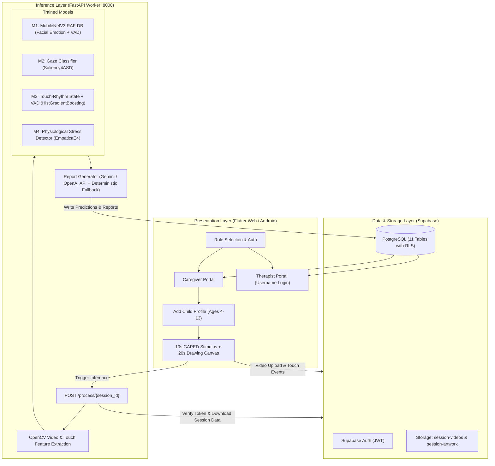

<div align="center">

# 🎨 ArtSpeak
### AI Art Therapy & Multimodal Assessment System for Autistic Individuals

**B.Tech Project — Department of Information Technology**  
**Vidyalankar Institute of Technology, Mumbai (Affiliated to University of Mumbai)**  
*Academic Year 2025–2026*

**Project Team:**  
Londhe Sankhya (23101A0007) · Pillai Arunima (23101A0015) · Jadhav Akanksha (23101A0016) · Meshram Alok (23101A0021)  
**Project Guide:** Dr. Rasika Ransing

[](https://flutter.dev)
[](https://fastapi.tiangolo.com)
[](https://pytorch.org)
[](https://scikit-learn.org)
[](https://supabase.com)
[](https://www.python.org)

</div>

---

## 📌 Executive Summary

Autistic children who are non-speaking, minimally verbal, or who experience alexithymia (difficulty identifying and naming feelings) are poorly served by emotion and well-being tools that require verbal or text input. 

**ArtSpeak** is a child-led digital drawing system that captures non-verbal signals during a structured, interest-themed session and turns them into a plain-language summary for caregivers and therapists. 

### Core Workflow:
1. **Child Onboarding & Profile**: Caregiver creates a child profile (age 4–13, gender, triggers, calming activities) and optionally pairs with an assigned verified therapist.
2. **Interest Selection (10s)**: The child selects a preferred theme (Animals, Nature, Objects, People) and views a calm stimulus image from a curated subset of the Geneva Affective PicturE Database (GAPED). Front-camera video recording begins with consent.
3. **Timed Drawing Phase (20s)**: The child draws with a prompt outline matching their chosen theme (e.g., tree, sun, butterfly) using sensory-friendly colors. High-frequency touch events (coordinates, timestamps, pressure) and front-camera video are recorded.
4. **Automated Inference**: A FastAPI backend extracts video and kinematic touch features, runs four session ML models (plus a fifth offline stimulus classifier), and synthesizes a dual caregiver/therapist report via an LLM (with deterministic rule-based fallback).
5. **Role-Based Portals**: Caregivers and therapists review session narratives, Valence-Arousal-Dominance (VAD) trajectories, and longitudinal dashboards protected by Supabase Row-Level Security (RLS).

> [!NOTE]
> **Scope & Clinical Notice**: ArtSpeak is a functional engineering prototype and **not** a diagnostic instrument. It does not determine whether a child has autism. All models were trained on public or synthetic benchmark datasets. Earlier conceptual explorations (such as GAN image generation, locally fine-tuned LLMs, or real-time wearable Bluetooth streaming) were not implemented in this version.

---

## 🏗 Architecture & System Design

ArtSpeak is structured across three cleanly decoupled layers communicating via authenticated interfaces:



---

## 🤖 The Five Machine Learning Models

ArtSpeak implements five distinct machine learning models trained on benchmark or curated datasets:

| Model | Purpose | Architecture | Dataset | Evaluation Results | Status in System |
| :--- | :--- | :--- | :--- | :--- | :--- |
| **M1: Facial Emotion & VAD** | Predicts 7 facial emotions + continuous 3D VAD coordinates | MobileNetV3-Large Dual-Head (PyTorch) | RAF-DB (15,339 images) | Accuracy: 57.30%, Macro-F1: 31.26%, VAD MAE: 0.256 | Active in live session pipeline |
| **M2: Gaze Attention Profile** | Distinguishes visual exploration patterns from gaze coordinates | Histogram Gradient Boosting (Scikit-Learn) | Saliency4ASD (6,961 scanpaths across 300 images) | Accuracy: 68.11%, ROC-AUC: 0.733, F1: 0.656 | Active in live session pipeline (descriptive only) |
| **M3: Touch-Rhythm State & VAD** | Classifies 6 behavioural states + continuous VAD from stroke kinematics | Histogram Gradient Boosting + Multi-Output Regressor | Synthetic touch sessions (7,200 sessions; 1,200 per state) | Accuracy: 96.81%, Macro-F1: 96.80%, VAD $R^2$: 0.922 (Valence) | Active in live session pipeline |
| **M4: Physiological Stress** | Detects autonomic physiological stress from 116 sensor features | Histogram Gradient Boosting (Scikit-Learn) | EmpaticaE4Stress (12,990 windows, 29 subjects) | Accuracy: 99.87%, ROC-AUC: 0.99998 | Implemented & trained (live session input inactive) |
| **M5: Interest-Theme Classifier** | Categorizes visual stimulus images into 4 interest themes | MobileNetV3-Large (PyTorch) | Curated GAPED dataset (210 images) | Validation Accuracy: 95.24%, Macro-F1: 95.98% | Standalone tool for curator asset tagging |

### Detailed Breakdown:

1. **M1 (Facial Emotion & 3D VAD)**:
   - Shared MobileNetV3-Large convolutional backbone producing a 960-dim feature vector.
   - Dual-head: Emotion classification head (7 classes: Surprise, Fear, Disgust, Happiness, Sadness, Anger, Neutral) + continuous VAD head (range $[-1, 1]$ via `tanh`).
   - *Report Caveat*: Under-trained (single recorded epoch checkpoint), biased toward Happiness due to dataset imbalance; Fear and Disgust were not predicted in the test split. The inference pipeline therefore treats M1 as secondary evidence relative to touch.

2. **M2 (Gaze Attention Profile)**:
   - Evaluates 16 kinematic gaze features (fixation count, spatial spread, scanpath length, dwell time statistics).
   - In live sessions, approximate eye positions are extracted using OpenCV Haar Cascades on webcam frames.
   - *Report Caveat*: Displayed solely as a descriptive attention profile (*"distinct non-verbal exploration"* or *"centred direct engagement"*), never as a diagnostic label.

3. **M3 (Touch & Kinematic Dynamics)**:
   - Extracts 7 raw touch features: mean pressure ($\bar{p}$), pressure variance ($\sigma^2_p$), mean speed ($\bar{v}$), mean curvature ($\bar{c}$), mean interval between touch-down events, tap regularity ($\bar{r}$), and stereotypy-burst flags.
   - Derives 6 kinematic indices: Kinetic Intensity, Tap Cadence, Rhythm Stability, Motor Fluidity, Dysregulation Ratio, and Pressure-Velocity Ratio.
   - Classifies 6 behavioral states: `Calm_Regulated`, `Engaged_Focused`, `Excited_Stimming`, `Anxious_Overstimulated`, `Distressed_PreMeltdown`, and `Withdrawn_FlatAffect`.

4. **M4 (Physiological Stress)**:
   - Trains on 116 statistical, temporal, and frequency-domain features from Empatica E4 wristband recordings (EDA, BVP, HR, TEMP, ACC).
   - *Report Caveat*: Trained to reproduce a feature-based heuristic stress rule. In live sessions, wearable streaming is inactive, and the feature extractor defaults to a calm baseline.

5. **M5 (Interest-Theme Classifier)**:
   - Standalone classifier categorizing images into `Animals`, `Nature`, `Objects`, and `People` to assist curators in expanding the stimulus gallery without disturbing the live session.

---

## 📝 Clinical & Caregiver Report Synthesis

After M1–M4 run on a session, outputs are formatted into a structured JSON payload sent to the LLM Report Synthesizer ([`caregiver_report_builder.py`](file:///C:/Users/sankhya/.gemini/antigravity/scratch/Artspeak/services/inference_engine/caregiver_report_builder.py)):

- **Primary Engine**: Google Gemini API (`gemini-3.5-flash` / `gemini-3-flash-preview`) or any OpenAI-compatible completions endpoint.
- **Deterministic Rule-Based Fallback**: If the LLM API key is missing or offline, a built-in deterministic rule engine generates the full report without failing. It maps touch state and kinematic intensity to a regulation score ($0$ to $100$) and applies heuristic fusion rules for Valence and Arousal.
- **Output Artifacts**:
  - Three-to-four paragraph plain-language narrative for parents (no pathologizing jargon).
  - 3–4 practical home environmental recommendations.
  - Longitudinal Valence trajectory curve across the 10-second stimulus and 20-second drawing phases.
  - Therapist clinical observation entry box for professional notes.

---

## 🔒 Database Architecture & Security (Supabase)

The PostgreSQL database comprises **11 relational tables** configured with strict Row-Level Security:

- **`caregivers`**: Stores profile information. Linked 1:1 with `auth.users`. Caregivers can access only their own child records and sessions.
- **`therapists`**: Clinical accounts with licensing information. Sign in using a system-generated username (e.g. `drananyasharma1359`) looked up via an RPC.
- **`children`**: Stores child details (age 4–13, condition, triggers, calming activities). No external photo PII is stored.
- **`child_therapist_assignments`**: Maps children to verified therapists (enforced by a partial unique index ensuring at most one active therapist per child).
- **`sessions`**, **`session_touch_events`**, **`session_video_recordings`**, **`session_artwork`**: Secure storage for session telemetry, touch points, and video clips.
- **`predictions_facial_emotion`**, **`predictions_touch_rhythm`**, **`session_reports`**: Output tables populated by the FastAPI worker via service-role authentication.

---

## 📂 Implemented Codebase Map

```
Artspeak/
├── config/
│   ├── frontend.env.example              # Client credentials (Supabase URL, Anon Key)
│   └── inference.env.example             # Worker credentials (Service Role Key, LLM Key)
├── data_prep/                            # Dataset cleaning & leakage-controlled preparation
│   ├── Clean_abide_phenotypic.py         # ABIDE demographic analysis (reviewed only)
│   ├── clean_empatica_4.py               # Empatica E4 signal extraction
│   ├── clean_gaped_dataset.py            # GAPED negative category removal & cleaning
│   ├── clean_saliency4asd.py             # Saliency4ASD scanpath processing
│   ├── extract_e4_features.py            # 116-feature physiological extractor
│   ├── inspect_e4.py                     # Sampling rate validation script
│   ├── prepare_rafdb_data.py             # RAF-DB alignment & verification
│   ├── prepare_rafdb_training_split.py   # Stratified split with hash deduplication
│   ├── prepare_training_data.py          # Training feature formatter
│   └── segregate_gaped_categories.py     # 4-theme image assignment (Animals, Nature, Objects, People)
├── frontend/                             # Flutter application
│   ├── assets/stimulus/                  # Curated calm GAPED images (210 total)
│   ├── lib/
│   │   ├── main.dart                     # App entry point
│   │   ├── models/                       # ChildProfile, SessionRecord models
│   │   ├── screens/
│   │   │   ├── welcome_screen.dart       # Role selection (Caregiver vs. Therapist)
│   │   │   ├── caregiver_login_screen.dart
│   │   │   ├── caregiver_signup_screen.dart
│   │   │   ├── caregiver_dashboard_screen.dart
│   │   │   ├── therapist_login_screen.dart
│   │   │   ├── therapist_signup_screen.dart
│   │   │   ├── therapist_dashboard_screen.dart
│   │   │   ├── child_details_screen.dart # Add child form with therapist assignment
│   │   │   ├── interest_selection_screen.dart # 10s stimulus display
│   │   │   ├── session_canvas_screen.dart     # 20s drawing canvas & camera feed
│   │   │   └── patient_report_screen.dart     # Detailed report & VAD trajectory
│   │   ├── services/
│   │   │   ├── art_speak_repository.dart # Supabase client repository
│   │   │   └── app_auth_cache.dart       # Session token caching
│   │   └── theme/app_theme.dart          # Low-sensory color tokens
│   ├── pubspec.yaml
│   └── run_with_env.sh                   # Launches Flutter with --dart-define-from-file
├── ml-models/                            # Model training scripts, confusion matrices & metrics
│   ├── e4_stress/                        # Model M4 (train_e4_stress_classifier.py)
│   ├── gaped_interest/                   # Model M5 (train_gaped_interest_classifier.py)
│   ├── gaze/                             # Model M2 (train_gaze_classifier_final.py)
│   ├── rafdb_emotion/                    # Model M1 (train_rafdb_classifier.py)
│   └── touch_rhythm/                     # Model M3 (train_touch_rhythm_classifier.py)
├── services/                             # FastAPI worker service
│   ├── inference_api.py                  # API endpoints (/process/{session_id}, /therapists)
│   ├── run_inference.sh                  # Backend launch script
│   └── inference_engine/
│       ├── caregiver_report_builder.py   # LLM & deterministic report synthesizer
│       ├── e4_processor.py               # E4 window feature extractor
│       ├── multimodal_engine.py          # Unified model loader (M1–M4)
│       ├── process_session.py            # End-to-end pipeline orchestrator
│       ├── touch_processor.py            # 13 kinematic feature calculator
│       └── video_processor.py            # Haar cascade face & gaze extractor
├── requirements.txt                      # Python dependencies
├── run_all.sh                            # Launches FastAPI worker & Flutter Web together
├── schema_therapist_assignment.sql       # Therapist assignment schema & triggers
├── supabase_rls_fix.sql                  # Updated RLS policies
├── supabase_schema.sql                   # 11-table core database schema
└── update_schema_interest_stimulus.sql   # Stimulus category schema
```

---

## 🛠 Setup & Installation Guide

### 1. Prerequisites
- **Flutter SDK**: `>= 3.0.0`
- **Python**: `>= 3.10`
- **Supabase Account**: Free or Pro project
- **Operating System**: macOS, Linux, or Windows

---

### 2. Database Provisioning (Supabase)

1. Open your project on the [Supabase Dashboard](https://supabase.com).
2. Open the **SQL Editor** and run the migration scripts in the following order:
   - `supabase_schema.sql` (Creates core tables: caregivers, therapists, children, sessions, etc.)
   - `supabase_rls_fix.sql` (Applies security policies)
   - `schema_therapist_assignment.sql` (Installs therapist selection and assignment triggers)
   - `update_schema_interest_stimulus.sql` (Seeds stimulus item tables)
3. Under **Authentication > Providers > Email**:
   - Enable Email signup.
   - For local development, disable **Confirm email** to test signup flows immediately.

---

### 3. Environment Setup

Create `.env.frontend` and `.env.inference` at the repository root from the examples:

#### **Frontend (`.env.frontend`)**
```env
SUPABASE_URL=https://YOUR_PROJECT_ID.supabase.co
SUPABASE_ANON_KEY=YOUR_SUPABASE_ANON_KEY
INFERENCE_API_URL=http://localhost:8000
```

#### **Backend Worker (`.env.inference`)**
```env
SUPABASE_URL=https://YOUR_PROJECT_ID.supabase.co
SUPABASE_SERVICE_ROLE_KEY=YOUR_SUPABASE_SERVICE_ROLE_KEY

# Optional: LLM Report Generation (Falls back to deterministic rule builder if omitted)
GEMINI_API_KEY=YOUR_GEMINI_API_KEY
# Or OpenAI:
# LLM_API_KEY=YOUR_OPENAI_API_KEY
# LLM_MODEL=gpt-4o-mini
# LLM_BASE_URL=https://api.openai.com/v1
```

> [!CAUTION]
> The `SUPABASE_SERVICE_ROLE_KEY` bypasses all Row-Level Security and must **only** be configured on the backend inference worker. Never expose it in the Flutter frontend or commit it to version control.

---

### 4. Running the Backend Worker

```bash
# Set up Python virtual environment
python -m venv .venv

# Activate environment:
# On Windows PowerShell:
.venv\Scripts\Activate.ps1
# On macOS / Linux:
source .venv/bin/activate

# Install dependencies
pip install -r requirements.txt

# Start the FastAPI inference worker on port 8000
uvicorn services.inference_api:app --host 127.0.0.1 --port 8000 --reload
```

---

### 5. Running the Flutter Frontend

```bash
cd frontend

# Install Flutter packages
flutter pub get

# Run on Chrome using environment defines
flutter run -d chrome --dart-define-from-file=../.env.frontend
```

---

### 6. Simultaneous Launch (Linux / macOS)

Run both the FastAPI backend and Flutter Web client simultaneously:
```bash
chmod +x run_all.sh
./run_all.sh
```

---

## 🔬 Scientific & Dataset Citations

- **RAF-DB**: S. Li, W. Deng, and J. Du, *"Reliable crowdsourcing and deep locality-preserving learning for expression recognition in the wild,"* CVPR, 2017.
- **Saliency4ASD**: H. Duan et al., *"A dataset of eye movements for children with autism spectrum disorder,"* MMSys, 2019; J. Gutiérrez et al., *Signal Processing: Image Communication*, 2021.
- **EmpaticaE4Stress**: S. Campanella et al., *"PPG and EDA dataset collected with Empatica E4 for stress assessment,"* *Data in Brief*, 2024.
- **GAPED**: E. S. Dan-Glauser and K. R. Scherer, *"The Geneva affective picture database (GAPED),"* *Behavior Research Methods*, 2011.
- **ABIDE**: Autism Brain Imaging Data Exchange (reviewed for background clinical phenotypes).

---

## 📜 Academic Honesty & Limitations

As documented in Chapter 4 of the project dissertation:
1. **No Autistic Children Were Recruited**: All models were trained on open adult benchmark datasets, task-transferred eye movements, or synthetic kinematic distributions. Clinical validation on consented autistic children is essential future work.
2. **Synthetic Touch Labels**: Model M3's $96.8\%$ score evaluates its ability to separate hand-specified distributions from the team's synthetic generator; real children's drawing kinematics require in-person validation.
3. **M4 Stress Rule Leakage**: Model M4 learns to reproduce the four-feature labelling rule defined during data preparation. In live sessions, wearable telemetry is not active.
4. **M1 Imbalance**: M1 was trained for a single epoch under heavy augmentation and shows a bias toward the majority class (Happiness); its predictions are treated as weak evidence by the fusion rules.
